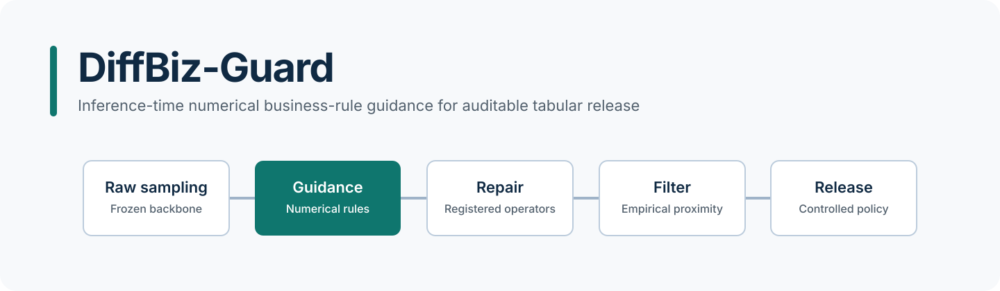
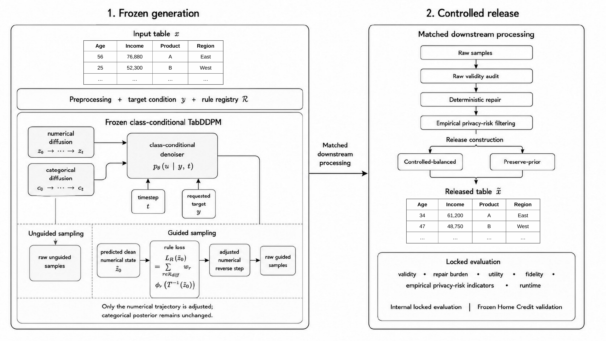
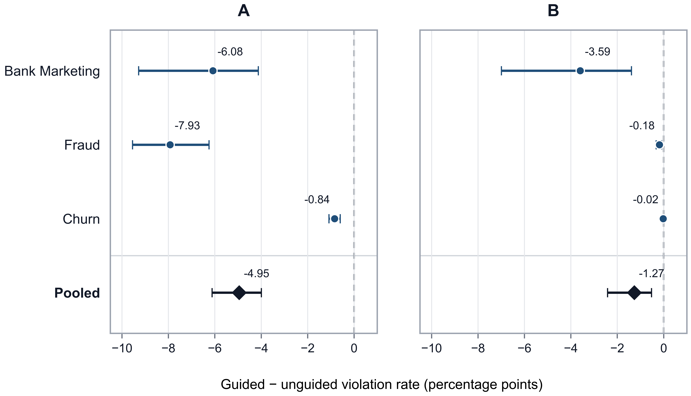
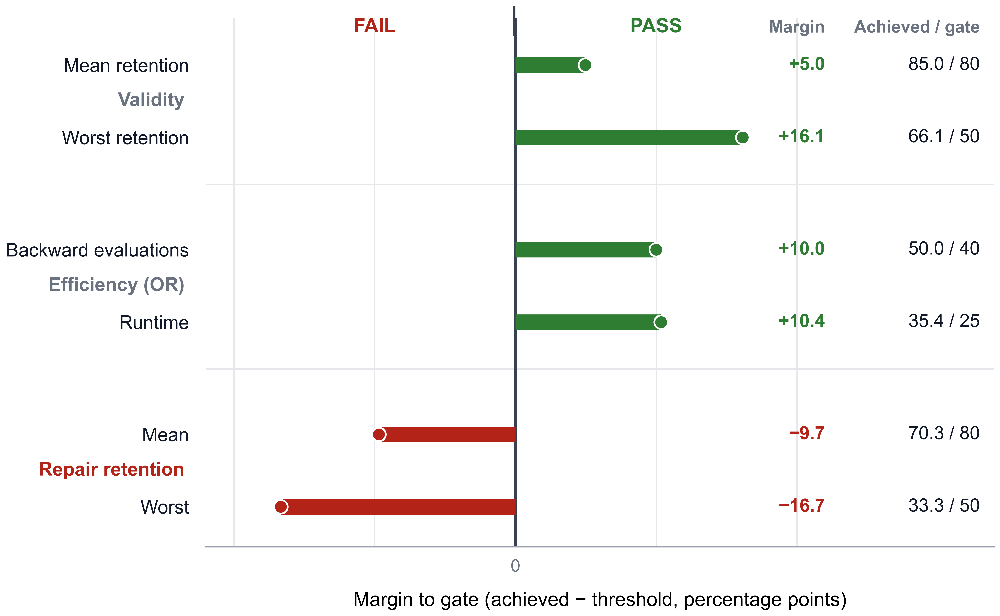

# DiffBiz-Guard

**Inference-Time Numerical Business-Rule Guidance for Auditable Synthetic Tabular Data Release**

DiffBiz-Guard guides the numerical reverse trajectory of a frozen mixed-type tabular diffusion model with registered business-rule penalties, then measures the effects of deterministic repair, empirical filtering, and controlled release construction as separate stages.

<p align="center">
  
</p>

<p align="center">
  
  
  
  
  <a href="LICENSE"></a>
</p>

<p align="center">
  <a href="#overview">Overview</a> ·
  <a href="#method">Method</a> ·
  <a href="#quick-start">Quick Start</a> ·
  <a href="#core-components">Core Components</a> ·
  <a href="#datasets">Datasets</a> ·
  <a href="#rule-registries">Registries</a> ·
  <a href="#reproducing-manuscript-tables">Results</a> ·
  <a href="#figures">Figures</a> ·
  <a href="#reproducibility">Reproducibility</a> ·
  <a href="#citation">Citation</a>
</p>

## Overview

The generator backbone remains frozen. During numerical reverse diffusion, DiffBiz-Guard estimates the clean state, maps it back to data space through differentiable inverse-quantile interpolation, evaluates supported registered numerical rules, and adjusts only the current numerical reverse mean. The categorical posterior is unchanged.

The resulting rows move through four auditable checkpoints:

1. **Raw generation** — preserve an uncorrected view of model behavior.
2. **Deterministic repair** — apply registered one-pass numerical repair operators.
3. **Empirical filtering** — reject exact training rows and rows below a train-derived nearest-neighbour threshold.
4. **Controlled release** — construct the requested release size and label policy from accepted proposals.

Each stage is reported separately so that guidance effects are not conflated with repair or filtering.

## Method

<p align="center">
  <a href="images/pipeline.png">
    
  </a>
</p>

For the supported lower-bound, bounded-range, and pairwise-order rules, the reverse-step objective uses squared hinge distances normalized by train-derived scales. The gradient is row-wise RMS-normalized, clipped, scaled by reverse variance, and applied only to the numerical trajectory. Domain rules use weight `1.00`; train-derived plausibility rules use `0.20`; the locked guidance strength is `0.10`.

Integer-schema and non-differentiable constraints do not enter the guidance gradient. They remain visible in the registry and are handled by audit or deterministic repair. See [Method details](docs/METHOD.md) for equations, API boundaries, and the release protocol.

## Quick Start

```bash
git clone https://github.com/rafa404/DiffBiz-Guard.git
cd DiffBiz-Guard
python -m pip install -r requirements.txt
python results/reproduce_tables.py --all
```

The table command uses the included compact result inputs; it does not need raw datasets or retraining.

A minimal repair call uses the public registry-oriented interface:

```python
from code.deterministic_repair import apply_repair_once

repaired, summary, ledger = apply_repair_once(frame, rules)
```

The guidance step is exposed as `guided_numerical_reverse_mean(...)`, and the empirical filter as `fit_release_filter(...)` plus `apply_release_filter(...)`. Runnable, dependency-light demonstrations are in [`examples/`](examples/).

## Core Components

| Module | Purpose |
|---|---|
| [`rule_losses.py`](code/rule_losses.py) | Differentiable lower-bound, range, and pairwise-order penalties. |
| [`diffusion_guidance.py`](code/diffusion_guidance.py) | Frozen-backbone numerical reverse-step guidance. |
| [`deterministic_repair.py`](code/deterministic_repair.py) | Ordered one-pass repair and stability diagnostics. |
| [`release_filter.py`](code/release_filter.py) | Exact-row and nearest-neighbour empirical filtering. |
| [`release_construction.py`](code/release_construction.py) | Label policies, proposal sizing, refill, and accepted-row selection. |
| [`evaluation_metrics.py`](code/evaluation_metrics.py) | Validity, repair, fidelity, calibration, and release metrics. |
| [`privacy_audits.py`](code/privacy_audits.py) | Empirical membership- and attribute-inference audits. |
| [`constraint_baselines.py`](code/constraint_baselines.py) | Direct clean-state guidance, rejection sampling, and matched linear projection. |

<details>
<summary><strong>Repository structure</strong></summary>

```text
code/          reusable method and evaluation modules
configs/       locked experiment and audit settings
registries/    complete rule registries for seven datasets
splits/        row-free split and preparation manifests
examples/      small public API demonstrations
results/       table inputs, seed-level evidence, validation records, builders
images/        final manuscript figures and repository visuals
docs/          method, datasets, reproduction, mapping, checksums, validation
```

</details>

## Rule Registries

Every registry row identifies a rule, affected columns, parameters, hard/soft status, differentiability, repair action, execution order, and provenance. The seven files under [`registries/`](registries/) contain:

| Dataset | Registry rows | Notes |
|---|---:|---|
| Bank Marketing | 47 | Domain, plausibility, and integer-schema rules. |
| Bank Account Fraud | 39 | Domain, plausibility, and integer-schema rules. |
| Large Customer Churn | 44 | Domain, plausibility, and integer-schema rules. |
| Home Credit | 167 per split | Three independently derived split contexts; 501 rows total. |
| Airline | 57 | Fixed-configuration breadth transfer. |
| Hotel | 41 | Fixed-configuration breadth transfer. |
| DataCo | 59 | Fixed-configuration breadth transfer. |

Hard rules are release-critical constraints. Soft rules record train-derived plausibility behavior. Differentiable rules may guide sampling; repair-only rules remain outside the gradient path.

## Datasets

Raw data are not redistributed. Obtain each dataset from its provider and follow the preparation record in [`docs/DATASETS.md`](docs/DATASETS.md) and the row-free manifests under [`splits/`](splits/).

| Dataset | Role | Source | Preparation summary |
|---|---|---|---|
| Bank Marketing | Internal | [Kaggle](https://www.kaggle.com/datasets/nisargpatel344/bank-marketing-dataset-for-term-deposit-prediction) | Complete 100,000-row table; identifier and leakage candidates excluded. |
| Bank Account Fraud | Internal | [Kaggle](https://www.kaggle.com/datasets/sgpjesus/bank-account-fraud-dataset-neurips-2022) | First 120,000 rows of `Variant V.csv`; stratified split. |
| Large Customer Churn | Internal | [Kaggle](https://www.kaggle.com/datasets/isandeep06/customer-churn-prediction-dataset-1m) | Preserved 120,000-row extract; identifier removed and date expanded. |
| Home Credit Default Risk | External transfer | [Kaggle competition](https://www.kaggle.com/competitions/home-credit-default-risk) | `application_train.csv` only; three independent 70/15/15 splits. |
| Airline Passenger Satisfaction | Breadth | [Kaggle](https://www.kaggle.com/datasets/teejmahal20/airline-passenger-satisfaction) | Concatenated sources; stratified sample to 120,000 rows. |
| Hotel Reservations | Breadth | [Kaggle](https://www.kaggle.com/datasets/ahsan81/hotel-reservations-classification-dataset) | Exact duplicates removed; 26,000-row modelling table. |
| DataCo Supply Chain | Breadth | [Kaggle](https://www.kaggle.com/datasets/shashwatwork/dataco-smart-supply-chain-for-big-data-analysis) | Stratified sample to 120,000 rows. |

## Reproducing Manuscript Tables

```bash
python results/reproduce_tables.py --all
python results/reproduce_tables.py --table stagewise
python results/reproduce_tables.py --table privacy
python results/reproduce_tables.py --table repair_sensitivity
```

Generated CSVs are written to [`results/manuscript_tables/`](results/manuscript_tables/). The builders copy or select rows from the public evidence files without recalculating experiments from raw records. See the complete [table mapping](docs/TABLE_MAPPING.md).

| Output | Scientific content |
|---|---|
| `baseline_grid.csv` | Descriptive internal baseline grid. |
| `real_reference.csv` | Real train/test rule-violation reference. |
| `stagewise.csv` | Raw → repair → filter → release attribution. |
| `internal_tstr.csv` | Internal TSTR utility and calibration. |
| `privacy.csv` | Independent empirical privacy-attack summary. |
| `home_credit.csv` | Home Credit transfer effects. |
| `lambda_grid.csv` | Guidance/policy validation grid. |
| `breadth.csv` | Exploratory breadth effects. |
| `repair_sensitivity.csv` | Repair-order and repeat-pass sensitivity. |
| `stabilisation_baselines.csv` | Stabilisation and matched constraint baselines. |

## Examples

- [`basic_guidance_example.py`](examples/basic_guidance_example.py) — a toy frozen denoiser showing the numerical guidance interface.
- [`repair_and_filter_example.py`](examples/repair_and_filter_example.py) — registry repair followed by train-fitted empirical filtering.
- [`evaluate_release_example.py`](examples/evaluate_release_example.py) — validity, repair-burden, and release-yield metrics.

The examples use small synthetic frames only to demonstrate interfaces; they do not represent paper results.

## Figures

### Framework

The pipeline above is the full-resolution framework asset used by the manuscript.

### Main evaluation figures

<table>
  <tr>
    <td width="50%" valign="top">
      <a href="images/Figure_02_Internal_Generator_Validity.png"></a><br>
      <strong>Figure 2 · Internal generator validity</strong><br>
      Raw numerical-rule validity effects across the internal datasets.
    </td>
    <td width="50%" valign="top">
      <a href="images/Figure_03_Home_Credit_Stage_Attribution.png"></a><br>
      <strong>Figure 3 · Home Credit stage attribution</strong><br>
      Separation of guidance, repair, filtering, and release effects.
    </td>
  </tr>
  <tr>
    <td width="50%" valign="top">
      <a href="images/Figure_04_Home_Credit_Tradeoffs.png"></a><br>
      <strong>Figure 4 · Home Credit trade-offs</strong><br>
      Validity, fidelity, utility, and release behavior in the transfer setting.
    </td>
    <td width="50%" valign="top">
      <a href="images/Figure_05_Sparse_Guidance_Selection.png"></a><br>
      <strong>Figure 5 · Sparse-guidance selection</strong><br>
      Guidance selection and the repair-retention gate.
    </td>
  </tr>
</table>

Figures are provided as final manuscript assets. Figure-generation code is not part of this compact reproducibility release.

## Reproducibility

The reported environment used Python 3.12.13, PyTorch 2.10.0, CUDA 12.8, and two Tesla T4 GPUs. The public release provides the core implementation, locked settings, complete registries, split metadata, compact result evidence, and deterministic table builders. It does not distribute raw provider data, generated samples, checkpoints, historical experiment notebooks, cloud-runtime orchestration, or figure-generation scripts.

See [Reproducibility](docs/REPRODUCIBILITY.md), [artifact checksums](docs/ARTIFACT_MANIFEST.md), and the quiet [release validation record](docs/RELEASE_VALIDATION.md).

## Scientific Scope and Limitations

- DiffBiz-Guard guides supported **numerical** rules; categorical posteriors are not guided.
- Integer and other non-differentiable constraints are audited or repaired, and deterministic repair remains necessary in the principal pipeline.
- Utility superiority or equivalence is not established; fidelity remains limited in several settings.
- Privacy results are empirical and attack-specific. They do not establish differential privacy or certified disclosure protection.
- The density-ratio membership audit is motivated by DOMIAS; it is not presented as an exact implementation of the original DOMIAS algorithm.
- Hard-rule rejection sampling was cheaper for obtaining hard-valid rows in the evaluated matched comparison.
- The direct clean-state comparator and matched projection are study-specific baselines, not full reproductions of HARPOON or a published projected-diffusion system.

## Citation

The manuscript is under revision. No DOI or publication metadata is asserted. Citation metadata is available in [`CITATION.cff`](CITATION.cff).

> M.M. Golam Hafiz, Safia Akter Simi, Md. Rakibul Islam, and Muhammad Firoz Mridha. *DiffBiz-Guard: Inference-Time Numerical Business-Rule Guidance for Auditable Synthetic Tabular Data Release.* Manuscript under revision.

## License, Data Terms, and Attribution

The software code is released under the [MIT License](LICENSE). Dataset access and use remain subject to the original providers' terms; the MIT License does not grant rights to third-party datasets. The manuscript and repository are attributed to M.M. Golam Hafiz, Safia Akter Simi, Md. Rakibul Islam, and Muhammad Firoz Mridha.
